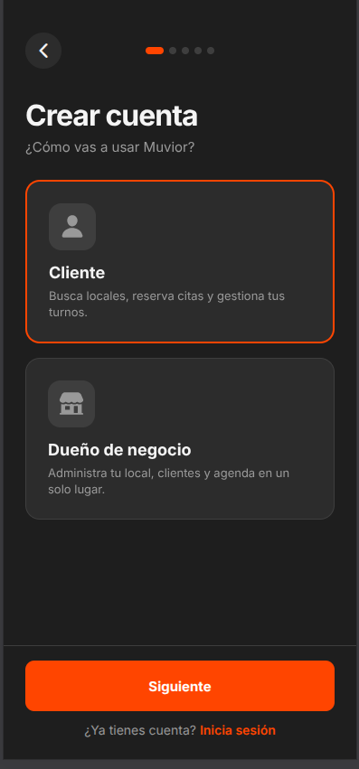
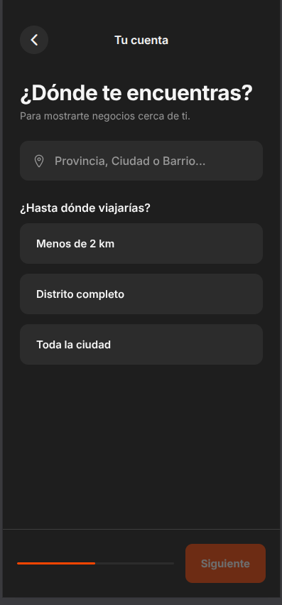
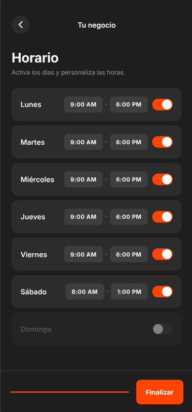
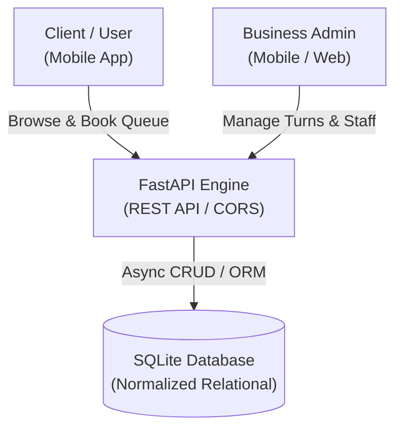
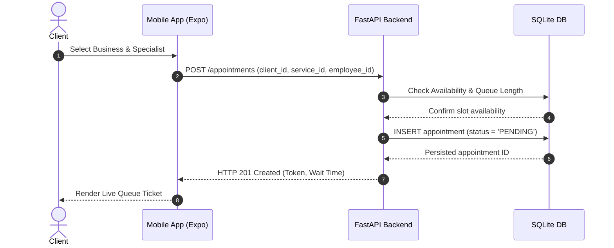

# Muvior — Real-Time Queue & Booking Management Platform

Muvior (*Movement + Valor*) is a cross-platform SaaS system engineered to replace crowded waiting rooms in micro-businesses (barbershops, beauty salons, and outpatient medical centers). By digitizing the traditional waiting process, Muvior allows clients to secure a virtual position in line from home while providing business owners with an operational control panel to orchestrate client flow across individual staff members.

---

## Visual Showcase

<div align="center">
  
  
  
  
  
</div>

---

## Architectural Design

The platform follows a decoupled client-server architecture. The mobile client communicates asynchronously with a high-performance Python service that validates business rules, computes live waiting estimates, and enforces relational integrity across users, appointments, and staff queues.



Clients discover nearby businesses, evaluate active queues, and choose a preferred specialist. The backend computes waiting times based on staff throughput, persists state transactions, and delivers live ticket confirmations to the mobile interface.



---

## Core Engineering Capabilities

The client interface is constructed with React Native and Expo Router, featuring file-based routing, hardware-accelerated transitions, and a strict dark-mode design system. State persistence handles local preferences, phone number formatting, and geographic scoping without blocking the main UI thread.

The backend service is powered by FastAPI and Python 3.12, utilizing Pydantic for request validation, structured error responses, and automatic OpenAPI schema generation. The SQLite database uses enforced foreign key constraints to maintain strict referential integrity across business profiles, services, and multi-employee schedules.

---

## Technology Stack

The solution is divided across two distinct layers:

- **Frontend Application:** React Native with Expo SDK 54, TypeScript, Expo Router, React Navigation, Vector Icons, and Async Storage.
- **Backend Service:** Python 3.12, FastAPI, Pydantic, Uvicorn, and SQLite.

---

## Getting Started

### Backend Service Setup
```bash
cd backend
python3 -m venv venv
source venv/bin/activate
pip install fastapi uvicorn pydantic

python3 seed_db.py
uvicorn main:app --reload --port 8000
```
API endpoints and schemas become available at `http://localhost:8000/docs`.

### Mobile Frontend Setup
```bash
cd frontend
npm install
npm start
```
The application can be launched on iOS, Android, or mobile web via Expo CLI.

---

## Author

Developed by **José Manuel Carvajal Florentino** ([@josecarvajal1058](https://github.com/josecarvajal1058)).
