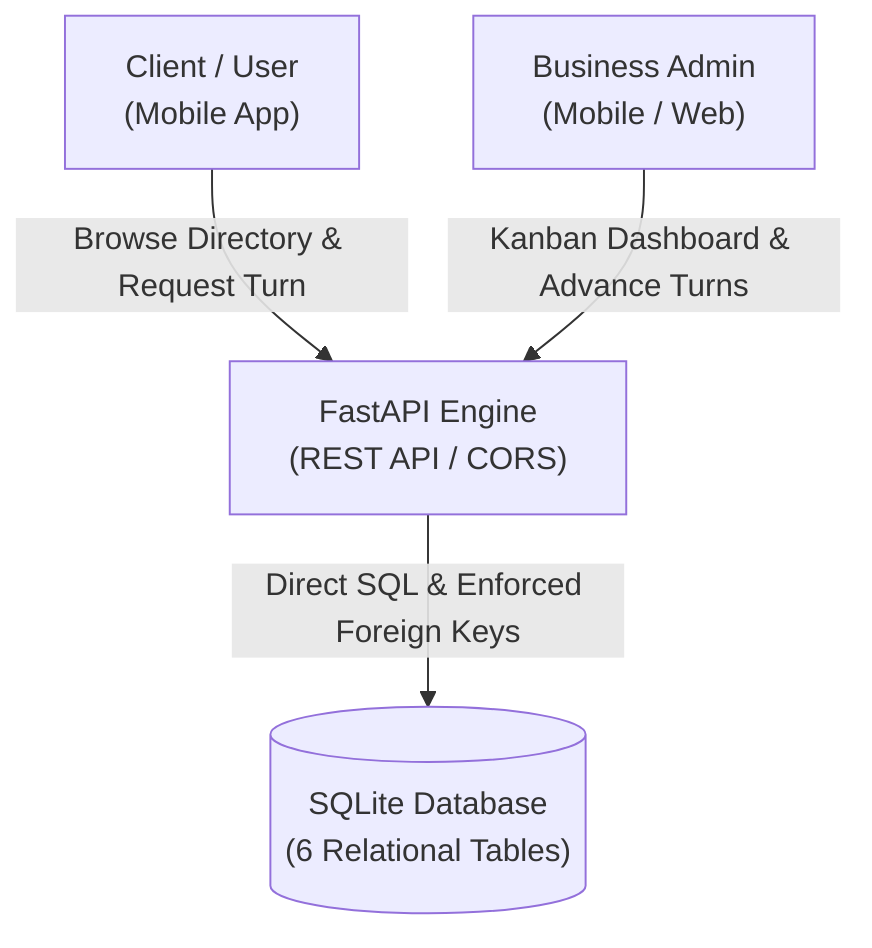
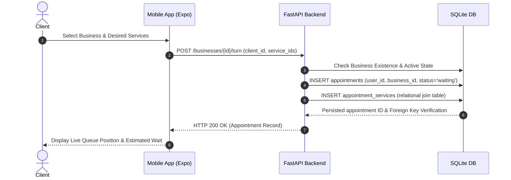

<div align="center">
  
  <h1>Muvior</h1>
  <p><strong>Full-Stack Remote Queue & Turn Management Prototype</strong></p>
  <p>A decoupled full-stack prototype engineered to streamline customer check-ins and eliminate crowded waiting rooms in micro-businesses (barbershops, beauty salons, and service clinics) through virtual queues and real-time turn tracking.</p>
</div>

---

## Visual Showcase

<div align="center">
  
  
  
  
  
</div>

---

## Architectural Design

The platform follows a decoupled client-server architecture. The mobile client communicates over REST with a Python backend service that processes turn lifecycles, manages queue state, and enforces relational integrity across users, appointments, and staff queues.



Clients discover nearby businesses, evaluate active queues, and join waiting lines. The mobile interface computes estimated wait times based on queue depth, while the backend coordinates state transitions and records appointments across relational tables.



---

## Core Engineering Capabilities

The client interface is constructed with React Native and Expo Router, featuring file-based routing, hardware-accelerated transitions, and a dark-mode design system. State persistence handles local preferences, phone number formatting, and geographic scoping without blocking the main UI thread.

The backend service is powered by FastAPI and Python 3.12, utilizing Pydantic models for request validation, PBKDF2-HMAC password hashing, automatic OpenAPI schema generation, and startup schema initialization. The SQLite database strictly enforces referential integrity through declared foreign keys and `PRAGMA foreign_keys = ON;` across 6 normalized tables (users, businesses, employees, services, appointments, and appointment_services).

---

## Technology Stack

The solution is divided across two distinct layers:

- **Frontend Application:** React Native with Expo SDK 54, TypeScript, Expo Router, React Navigation, Vector Icons, and Async Storage.
- **Backend Service:** Python 3.12, FastAPI, Pydantic, Uvicorn, SQLite3, and PBKDF2-HMAC security.

---

## Getting Started

### Backend Service Setup
```bash
cd backend
python3 -m venv venv
source venv/bin/activate
pip install -r requirements.txt

python3 seed_db.py
uvicorn main:app --reload --port 8000
```
Interactive API documentation and schemas are available at `http://localhost:8000/docs`.

### Mobile Frontend Setup
```bash
cd frontend
npm install
npm start
```
The application can be launched on iOS, Android, or mobile web via Expo CLI.

---

## Repository Structure

```text
├── backend/
│   ├── database.py       # SQLite connection, DDL schema & PRAGMA foreign_keys
│   ├── main.py           # 15 FastAPI endpoints, CORS & Lifespan handler
│   ├── requirements.txt  # Pinned backend dependencies
│   ├── security.py       # PBKDF2-HMAC password hashing & verification
│   └── seed_db.py        # Relational dataset generator & test users
├── frontend/
│   ├── app/              # File-based routing (Expo Router)
│   ├── app.json          # Expo configuration (Muvior namespace)
│   ├── assets/           # Media, brand icons & splash assets
│   └── package.json      # React Native & Expo SDK 54 dependencies
└── docs/
    └── screenshots/      # Mobile UI verification captures
```
