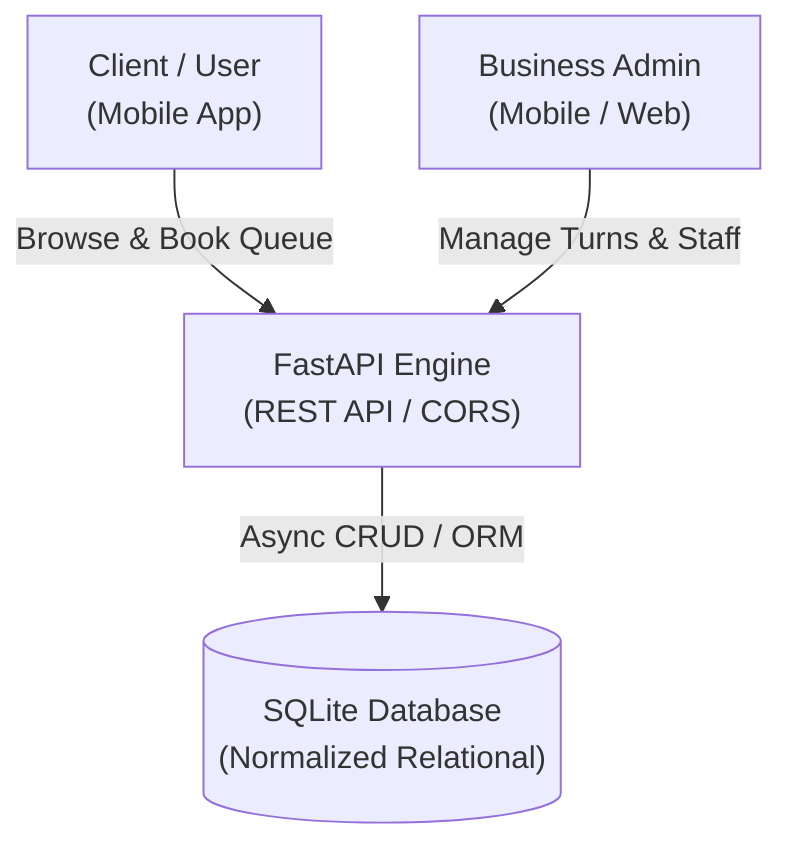
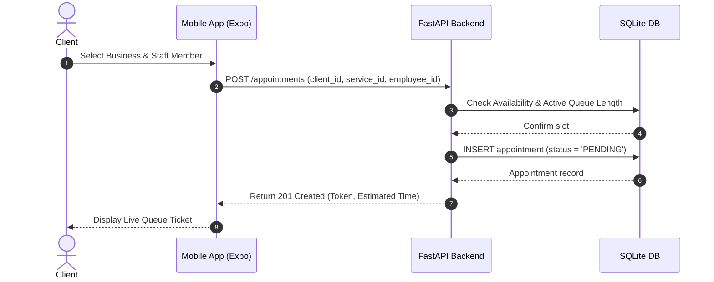
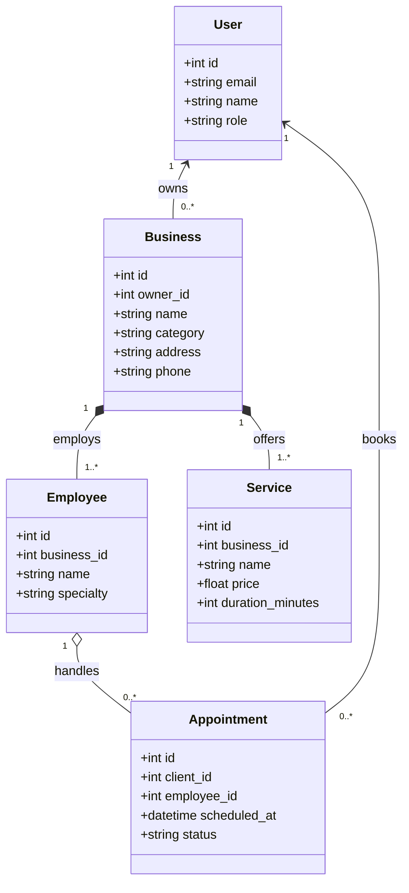

# Muvior — Real-Time Queue & Booking Management Platform

A cross-platform SaaS platform designed to eliminate waiting rooms in service micro-businesses (barbershops, beauty salons, and outpatient clinics) through virtual queueing and real-time appointment management.

---

## Architecture Overview

Muvior implements a decoupled client-server architecture with an asynchronous backend and an Expo-driven mobile frontend.



---

## Sequence Flow: Remote Turn Allocation



---

## Domain Model (Class Diagram)



---

## Tech Stack

| Layer | Technologies |
| :--- | :--- |
| **Frontend** | React Native, Expo SDK 54, Expo Router, TypeScript, React Navigation |
| **Backend** | Python 3.12, FastAPI, Pydantic, Uvicorn |
| **Database** | SQLite (Relational Schema with Foreign Key enforcement) |
| **Tooling** | Git, ESLint, TypeScript Compiler |

---

## Repository Structure

```text
Muvior/
├── backend/
│   ├── main.py          # FastAPI REST endpoints & business logic
│   ├── database.py      # SQLite connection & schema initialization
│   └── seed_db.py       # Fixture seeding for local development
├── frontend/
│   ├── app/             # File-based routing (onboarding, tabs, admin)
│   ├── components/      # Modular UI components (Pickers, Inputs)
│   ├── constants/       # Design tokens & Dominican Republic presets
│   ├── hooks/           # Custom React hooks
│   ├── package.json     # Node dependencies & scripts
│   └── tsconfig.json    # Strict TypeScript configuration
└── README.md            # Technical specifications
```

---

## Quick Start

### Backend
```bash
cd backend
python3 -m venv venv
source venv/bin/activate
pip install fastapi uvicorn pydantic

python3 seed_db.py       # Initialize & seed SQLite DB
uvicorn main:app --reload --port 8000
```
Interactive OpenAPI docs: `http://localhost:8000/docs`.

### Frontend
```bash
cd frontend
npm install
npm start
```

---

## Author
**José Manuel Carvajal Florentino** — Software Engineering Student at **Universidad del Caribe (UNICARIBE)**.
GitHub: [@josecarvajal1058](https://github.com/josecarvajal1058)
